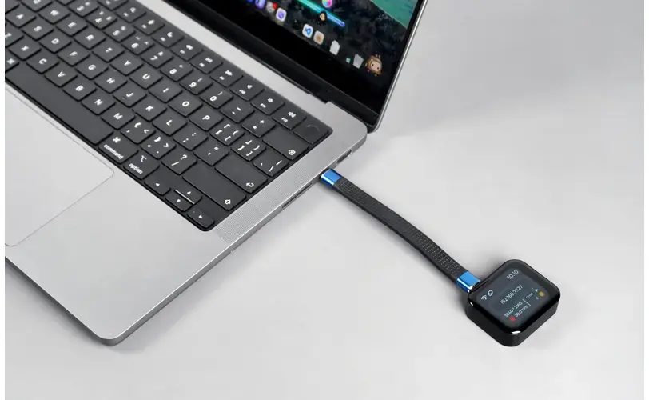
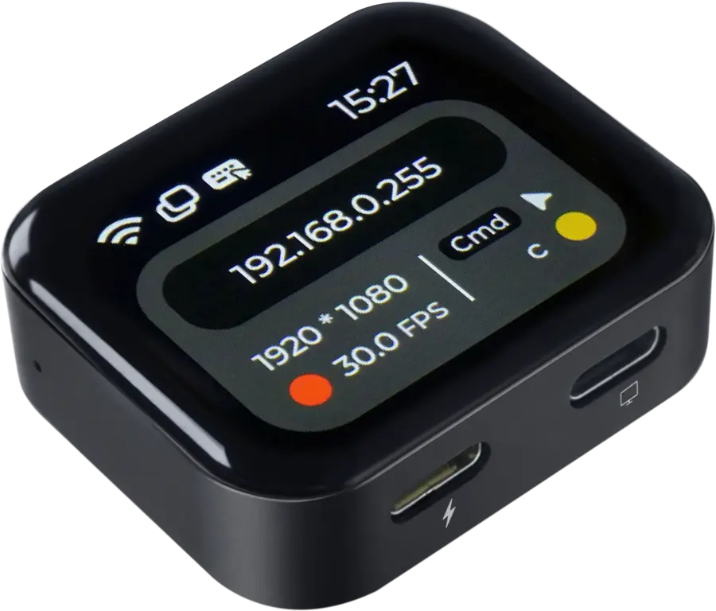
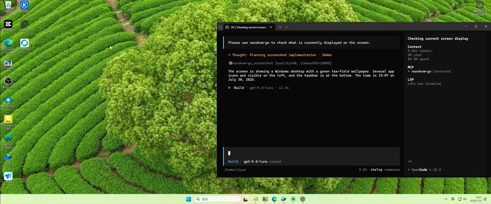
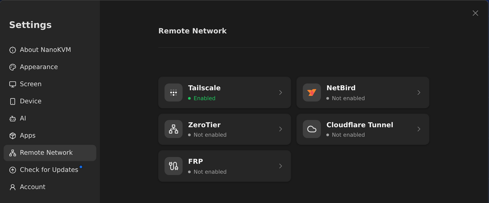
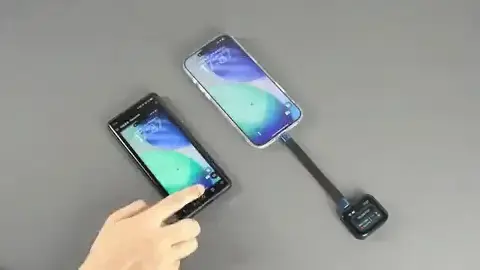
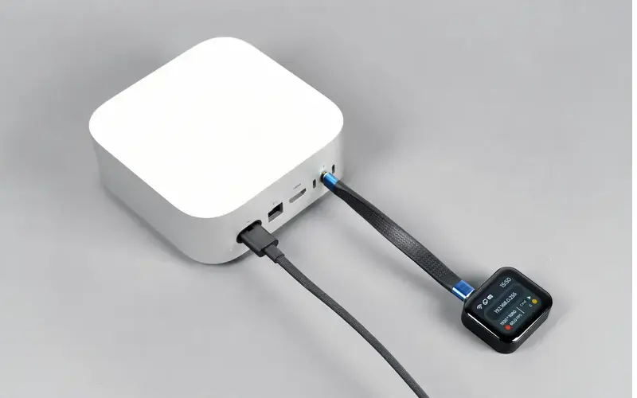
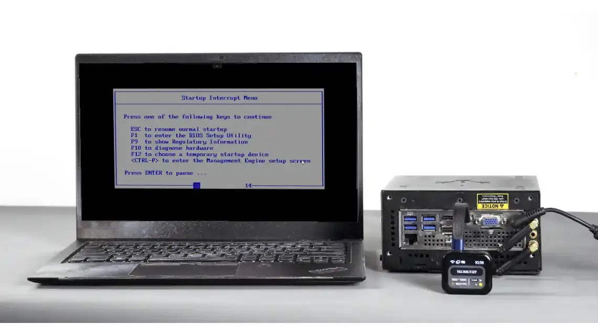
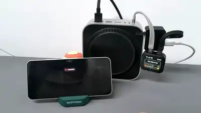

# NanoKVM-Go

English | [中文](README.zh.md)

   
  
  <h3>
    <a href="https://wiki.sipeed.com/hardware/en/kvm/NanoKVM_Go/quick_start.html">🚀 Quick Start</a>
     |
    <a href="https://wiki.sipeed.com/hardware/en/kvm/NanoKVM_Go/user_guide.html">📖 User Guide</a>
     |
    <a href="https://github.com/sipeed/NanoKVM-Go/releases/latest">💾 Firmware Download</a>
  </h3>
   

## 🌟 What is NanoKVM-Go?

NanoKVM-Go is the open-source software repository for the **NanoKVM Go series**, a palm-sized USB-C KVM from [Sipeed](https://sipeed.com) optimized for phones, tablets, and portable computers. After the initial network setup, connect it to a device that outputs video over USB-C and control that device from a browser on another phone or computer — screen, clicks, swipes, and typing.

Unlike remote desktop software, NanoKVM Go captures the display and emulates keyboard, mouse, and storage devices at the hardware level. The target needs no dedicated driver or remote-control client, and it keeps working when the operating system is frozen, offline, or not yet installed. That makes it useful for UEFI/BIOS setup, OS installation, and recovery as well as everyday remote assistance.

The Go series also ships comprehensive AI integration: an optional MCP server lets compatible agents see the screen and send input, and Go+ adds an on-device NPU, Memory Fabric, and Screen Timelapse — searchable text and context extracted from screen changes.

## 📦 Product Family

NanoKVM is a family of compact, open-source IP-KVM devices. Choose the one that matches your deployment:

- **NanoKVM Go** (this repository): a USB-C KVM for phones, tablets, laptops, mini PCs, and handhelds. One full-featured USB-C cable carries video, audio, HID input, virtual media, and a virtual NIC.
- **NanoKVM Go+** (this repository): builds on NanoKVM Go with a 3.2 TOPS NPU, more memory and storage, Memory Fabric, and Screen Timelapse.
- **[NanoKVM Cube / PCIe](https://github.com/sipeed/NanoKVM):** the classic models based on the LicheeRV Nano (SG2002), with 1080P @ 60 fps capture and an optional PCIe form factor.
- **[NanoKVM-Pro](https://github.com/sipeed/NanoKVM-Pro):** the high-performance model with 4K capture, HDMI loop-out, 1Gbps Ethernet, and PoE.
- **[NanoKVM-USB](https://github.com/sipeed/NanoKVM-USB):** a USB-based KVM solution that needs no network on the target side.
- 🔜 **[NanoKVM Air](https://github.com/sipeed/NanoKVM-Air):** an entry-level, low-cost IP-KVM with 1080P @ 60 fps, dual-band Wi-Fi, a 1.47-inch touchscreen, and Finger Robot support. Coming soon — stay tuned!!!

Both Go models share the same KVM, MCP, wireless, and expansion capabilities; choose Go+ for more AI compute, Memory Fabric, and Screen Timelapse.

## ✨ Features

### 4K remote control over one USB-C cable

The main USB-C port takes a single cable: the target's screen (up to 4K @ 50 Hz) and audio come back, your keyboard and mouse input go the other way, and you don't need a capture card or adapter. When you need to install an OS or move files, the target sees a virtual USB drive; when it needs a network, it sees a virtual network adapter. The second USB-C port accepts power and passes it through to the target, so the target keeps charging during long sessions.

  

### Equipped with a color touchscreen

The 1.83-inch color touchscreen shows the IP address, current resolution, and frame rate, and handles Wi-Fi, display, and session settings. The platform is open: install custom apps to turn the small screen into a clock, a system monitor, or a desktop widget.

  

### Connect real devices to AI agents

MCP lets AI models call external tools. If your AI tool supports MCP, the agent can see the target's screen and click and type for you: it captures the current screen to check the state, then performs the action. MCP is off by default; turn it on in Settings.

Go+ adds Memory Fabric and Screen Timelapse: Memory Fabric turns on-screen text and context into searchable records, and Screen Timelapse lets you replay that screen history and search what was captured.

  
   
  Click to view the full screenshot

### Supports multiple remote access options

Remote access works away from home: Tailscale is built in, and you can also use ZeroTier, NetBird, frp, or Cloudflare Tunnel, with no port forwarding on your router. Video capture and input emulation happen in hardware, so the target runs no resident software; unplug the cable and the remote session ends.

  

## 🧭 Typical Use Cases

### Helping family with phones and tablets

Leave a configured NanoKVM Go at home. When a family member needs help, they plug it into their phone or tablet with a full-featured USB-C cable, and you control the device from a browser on your own phone or computer instead of describing every button over a call.

  

### Maintaining laptops, mini PCs, and handhelds on the go

At roughly 45 × 40 × 15 mm, the device fits in a tool pouch and moves between MacBooks, mini PCs, Windows laptops, and Steam Decks. A built-in magnet lets it stick to a chassis or a metal stand.

  

### Recovering a device when its system is unavailable

When the system is frozen, offline, or cannot boot, remote desktop and SSH usually go down with it. NanoKVM Go still shows the boot screen, so you can enter UEFI/BIOS, change the boot order, or mount an ISO to reinstall.

  

If the target is completely unresponsive and neither the system nor the network responds, add the Finger Robot: mount it next to the chassis power button and you can press that button physically from anywhere, so you can power the device on or off, or force a shutdown (holding the power button may lose unsaved data). See the [Finger Robot guide](https://wiki.sipeed.com/hardware/en/kvm/NanoKVM_Go/finger_robot.html) for wiring and setup.

  
   
  Full demo — click to watch

## 🛠️ Specifications

| Item | NanoKVM Go / Go+ | NanoKVM Cube / PCIe | NanoKVM-Pro |
| --- | --- | --- | --- |
| Core | Go: 2 × Cortex-A53 Go+: 2 × Cortex-A53 + 3.2 TOPS NPU | 1 × C906 @ 1.0 GHz | 2 × Cortex-A53 @ 1.2 GHz |
| Memory & Storage | Go: 256 MB LPDDR4x + 16 GB Go+: 512 MB LPDDR4 + 64 GB | 256 MB DDR3 + 32 GB | 1 GB LPDDR4X + 32 GB |
| Max Capture | 4K @ 50 Hz; 2K @ 90 Hz | 1080P @ 60 fps | 4K @ 45 fps; 2K @ 95 fps |
| Codec | H.264 / H.265 | MJPEG / H.264 | MJPEG / H.264 / H.265 |
| Audio | Two-way audio | — | Two-way audio |
| UEFI / BIOS | ✓ | ✓ | ✓ |
| Emulated USB Keyboard & Mouse | ✓ | ✓ | ✓ |
| Emulated USB ISO | ✓ | ✓ | ✓ |
| Wake-on-LAN | ✓ | ✓ | ✓ |
| Web Terminal | ✓ | ✓ | ✓ |
| Custom Scripts | ✓ | ✓ | ✓ |
| Wi-Fi | Built-in Wi-Fi 6 | Optional Wi-Fi 6 | Optional Wi-Fi 6 |
| Display | 1.83-inch color touchscreen | 0.96-inch OLED | 1.47-inch LCD / 0.96-inch OLED |
| More Features | Go: Finger Robot, MCP Go+: Finger Robot, MCP, Memory Fabric, Screen Timelapse | MCP | LED strip sync, Smart Assistant |
| Power Input | USB-C PD | USB-C / PoE / PCIe | USB-C / PoE |
| Dimensions | 45 × 40 × 15 mm | 40 × 36 × 36 mm | 65 × 65 × 28 mm |

> Values are the hardware maximum capture capability; the modes actually available depend on EDID, OS, and interface — see [Resolution and EDID Settings](https://wiki.sipeed.com/hardware/en/kvm/NanoKVM_Go/resolution.html). 4K @ 50 Hz on Go is currently Beta; Pro's 4K45 / 2K95 require a future update, and Pro ships at 4K30 / 2K60.

## 📂 Repository Layout

This repository is the build and packaging entry point for the series. Each component is built into `build/` and then packaged into Debian packages.

| Path | Contents |
| --- | --- |
| [`server/`](server) | Go backend: API, authentication, HID, streaming, extensions |
| [`web/`](web) | React + TypeScript web UI |
| [`kvm_ui/`](kvm_ui) | Local LVGL touch UI for the device screen |
| [`kvm_vin/`](kvm_vin) | Video capture and encoding pipeline |
| [`libkvm/`](libkvm) | Hardware abstraction library |
| [`nano_ocr/`](nano_ocr) | OCR runtime |
| [`memfab/`](memfab) | Memory Fabric runtime for OCR-backed local memory |
| [`debhelper/`](debhelper) | Debian packaging for `kvmcomm` and `nanokvm-go` |
| [`support/`](support) | Toolchain setup, packaging scripts, kernel patches, release keys |
| [`docs/`](docs) | Architecture, API, and build documentation |

The `debhelper/packages/kvmcomm/rootfs/kvmcomm/apps` directory is a Git submodule; clone with `--recurse-submodules`, or run `git submodule update --init --recursive` after cloning.

## 📚 Documentation

Complete product documentation lives on the [Sipeed wiki](https://wiki.sipeed.com/hardware/en/kvm/NanoKVM_Go/introduction.html): [Quick Start](https://wiki.sipeed.com/hardware/en/kvm/NanoKVM_Go/quick_start.html) · [User Guide](https://wiki.sipeed.com/hardware/en/kvm/NanoKVM_Go/user_guide.html) · [System Build](https://wiki.sipeed.com/hardware/en/kvm/NanoKVM_Go/system/introduction.html) · [Flashing](https://wiki.sipeed.com/hardware/en/kvm/NanoKVM_Go/system/flashing.html) · [FAQ](https://wiki.sipeed.com/hardware/en/kvm/NanoKVM_Go/faq.html).

| Document | Description |
| --- | --- |
| [Build and Packaging Guide](docs/build-packaging.md) | Repository-level build, Debian packaging, update bundles, and signing details |
| [Changelog](CHANGELOG.md) | Notable changes and release history |
| [MCP Usage](docs/mcp-usage.md) | Enable and use the MCP server with AI clients |
| [Storage and File Sharing](docs/storage.md) | Virtual media, ISO/IMG mounting, and file transfer API |
| [Input Router Architecture](docs/input-router.md) | Input routing, session ownership, and the tested client matrix |
| [USB HID Notes](docs/kvmgo-device-usb-hid.md) | HID report descriptors for mouse, stylus, and multi-touch |
| [Two-Factor Authentication](docs/2fa.md) | TOTP setup and runtime files |

## 🔌 Compatibility

The target must expose video over a USB-C port that supports **DisplayPort Alt Mode**; ports limited to charging or plain USB data cannot carry video. Apple devices work only in the model ranges listed on the wiki (for example iPhone 15 and later, excluding iPhone 16e and 17e, with AssistiveTouch enabled). The controlling device only needs a modern browser that can reach NanoKVM Go.

See the [compatibility tables](https://wiki.sipeed.com/hardware/en/kvm/NanoKVM_Go/introduction.html#Compatible-Devices) on the wiki for the complete, current list.

## 🤝 Contributing

Issues and pull requests are welcome. To get started:

1. Fork the repository.
2. Create a feature branch.
3. Commit your changes.
4. Push to the branch.
5. Open a Pull Request.

Please run the relevant component builds and tests before submitting a change, keep pull requests small and focused, and make each commit cover a single change.

## 🛒 Where to Buy

- [Taobao](https://item.taobao.com/item.htm?id=1093779349345)
- [AliExpress](https://www.aliexpress.us/item/3256813383201819.html)

## 💬 Community & Support

- [Discord](https://discord.gg/V4sAZ9XWpN)
- QQ group: 703230713
- Email: [support@sipeed.com](mailto:support@sipeed.com)
- [FAQ](https://wiki.sipeed.com/hardware/en/kvm/NanoKVM_Go/faq.html)

## 📜 License

NanoKVM-Go is released under the [GNU General Public License v3.0](LICENSE).
