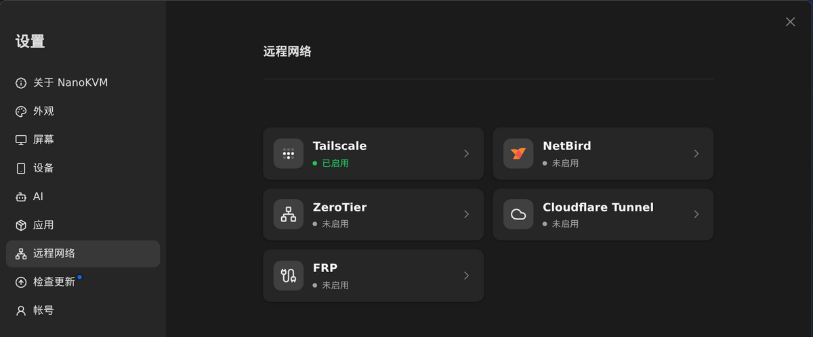
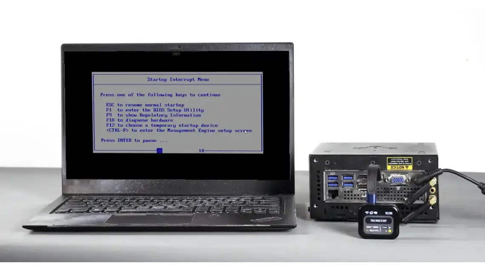

# NanoKVM-Go

[English](README.md) | 中文

   
  
  <h3>
    <a href="https://wiki.sipeed.com/hardware/zh/kvm/NanoKVM_Go/quick_start.html">🚀 快速开始</a>
     |
    <a href="https://wiki.sipeed.com/hardware/zh/kvm/NanoKVM_Go/user_guide.html">📖 使用指南</a>
     |
    <a href="https://github.com/sipeed/NanoKVM-Go/releases/latest">💾 固件下载</a>
  </h3>
   

## 🌟 NanoKVM-Go 是什么？

NanoKVM-Go 是 **NanoKVM Go 系列**的开源软件仓库。该系列是 [Sipeed](https://sipeed.com) 推出的掌上 USB-C KVM，针对手机、平板和便携电脑优化。完成初始网络配置后，将它连接到支持 USB-C 视频输出的设备，即可从另一台手机或电脑的浏览器中查看画面，并进行点击、滑动和输入。

与远程桌面软件不同，NanoKVM Go 从硬件层采集画面，并以硬件方式模拟键盘、鼠标和存储设备。被控端无需安装专用驱动或远程控制客户端；即使操作系统卡死、无法联网或尚未启动，也能用于 UEFI/BIOS 设置、系统安装和故障排查，同样适合日常的远程协助。

Go 系列还提供完善的 AI 集成：可选的 MCP Server 让兼容 MCP 的 AI 工具获取画面并发送键鼠操作；Go+ 额外配备端侧 NPU、记忆织网与屏幕延时回放，可从画面变化中提取可检索的文字与上下文。

## 📦 产品家族

NanoKVM 是一系列紧凑的开源 IP-KVM 设备，可根据部署场景选择：

- **NanoKVM Go**（本仓库）：面向手机、平板、笔记本、迷你主机和掌机的 USB-C KVM。一根全功能 USB-C 线缆即可同时承载视频、音频、键鼠输入、虚拟介质和虚拟网卡。
- **NanoKVM Go+**（本仓库）：在 NanoKVM Go 的基础上，增加 3.2 TOPS NPU、更大的内存与存储，以及记忆织网和屏幕延时回放。
- **[NanoKVM Cube / PCIe](https://github.com/sipeed/NanoKVM)：** 基于 LicheeRV Nano（SG2002）的经典型号，支持 1080P @ 60 fps 采集，并提供 PCIe 形态。
- **[NanoKVM-Pro](https://github.com/sipeed/NanoKVM-Pro)：** 高性能型号，支持 4K 采集、HDMI 环出、千兆网口和 PoE。
- **[NanoKVM-USB](https://github.com/sipeed/NanoKVM-USB)：** 基于 USB 的 KVM 方案，被控端无需联网。
- 🔜 **[NanoKVM Air](https://github.com/sipeed/NanoKVM-Air)：** 入门级、低成本 IP-KVM，支持 1080P @ 60 fps、双频 Wi-Fi、1.47 英寸触摸屏和手指机器人。即将上市，敬请期待!!!

两个 Go 型号的 KVM、MCP、无线网络和扩展能力相同；需要更强 AI 算力、记忆织网和屏幕延时回放时选 Go+。

## ✨ 功能特性

### 一根 USB-C 线实现 4K 远程控制

主 USB-C 接口只需接一根线：被控设备的画面（最高 4K @ 50 Hz）和声音传回来，你的键鼠操作传过去，不需要额外的采集卡或转接器。需要装系统或传文件时，被控设备会多出一个 U 盘；需要联网时，也可以给它加一块网卡。另一个 USB-C 接口用来接电源，把电直接送给被控设备，长时间使用也不怕没电。

  

### 配备彩色触摸屏

1.83 英寸彩色触摸屏显示 IP 地址、当前分辨率和帧率，也可以直接完成 Wi-Fi、显示和会话设置。平台开放，支持安装自定义应用，把这块小屏幕变成时钟、系统监控或桌面小部件。

  

### 将真实设备接入 AI Agent

MCP 是一种让 AI 调用外部工具的协议。如果你在用支持它的 AI 工具，可以让它直接看到被控设备的画面、替你点击和打字：AI 会先截一张当前画面确认状态，再执行操作。MCP 默认关闭，需要你在设置里手动打开。

如果用的是 Go+，还额外支持记忆织网和屏幕延时回放：记忆织网会把屏幕上的文字和上下文整理成可检索的记录，屏幕延时回放可以按时间回看历史画面，并搜索其中的内容。

  
   
  点击查看完整截图

### 支持多种远程访问方式

不在家也能远程访问：内置 Tailscale，还支持 ZeroTier、NetBird、frp 和 Cloudflare Tunnel，不必在自家路由器上做端口映射。画面采集与键鼠模拟都在硬件层完成，被控设备上不用装任何常驻软件；把线拔掉，远程连接就断开了。

  

## 🧭 典型应用场景

### 远程协助家人使用手机和平板

把配置好 Wi-Fi 和远程访问的 NanoKVM Go 留在家中。家人需要帮助时，用一根全功能 USB-C 线把它接到手机或平板，你就可以从自己的手机或电脑浏览器里直接查看并操作设备，不必再在电话里一步步描述按钮的位置。

  

### 随身维护笔记本、迷你主机和掌机

NanoKVM Go 的机身约 45 × 40 × 15 mm，可以放进工具包，在 MacBook、迷你主机、Windows 笔记本和 Steam Deck 之间随插随用。机身内置磁铁，也可以吸附在机箱或金属支架上。

  

### 系统无法启动时远程救援

当设备卡死、无法联网或进不了系统时，远程桌面和 SSH 往往也一起失效。NanoKVM Go 仍然能输出启动画面，让你进入 UEFI/BIOS、修改启动项，或者挂载 ISO 镜像重装系统。

  

如果设备彻底无响应，既进不了系统也无法连网，还可以加装手指机器人：把它固定在机箱电源键旁边，就能从远端物理按下电源键，完成开机、关机或强制断电（长按电源键可能丢失未保存的数据）。接线和操作见[手指机器人使用指南](https://wiki.sipeed.com/hardware/zh/kvm/NanoKVM_Go/finger_robot.html)。

  
   
  完整演示，点击查看视频

## 🛠️ 技术规格

| 项目 | NanoKVM Go / Go+ | NanoKVM Cube / PCIe | NanoKVM-Pro |
| --- | --- | --- | --- |
| 核心 | Go：2 × Cortex-A53 Go+：2 × Cortex-A53 + 3.2 TOPS NPU | 1 × C906 @ 1.0 GHz | 2 × Cortex-A53 @ 1.2 GHz |
| 内存与存储 | Go：256 MB LPDDR4x + 16 GB Go+：512 MB LPDDR4 + 64 GB | 256 MB DDR3 + 32 GB | 1 GB LPDDR4X + 32 GB |
| 最大采集 | 4K @ 50 Hz；2K @ 90 Hz | 1080P @ 60 fps | 4K @ 45 fps；2K @ 95 fps |
| 编解码器 | H.264 / H.265 | MJPEG / H.264 | MJPEG / H.264 / H.265 |
| 音频传输 | 双向音频 | — | 双向音频 |
| UEFI / BIOS | ✓ | ✓ | ✓ |
| 模拟 USB 键鼠 | ✓ | ✓ | ✓ |
| 模拟 USB ISO | ✓ | ✓ | ✓ |
| 网络唤醒 | ✓ | ✓ | ✓ |
| Web 终端 | ✓ | ✓ | ✓ |
| 自定义脚本 | ✓ | ✓ | ✓ |
| Wi-Fi | 内置 Wi-Fi 6 | 可选 Wi-Fi 6 | 可选 Wi-Fi 6 |
| 显示屏 | 1.83 英寸彩色触摸屏 | 0.96 英寸 OLED | 1.47 英寸 LCD / 0.96 英寸 OLED |
| 其他功能 | Go：手指机器人、MCP Go+：手指机器人、MCP、记忆织网、屏幕延时回放 | MCP | 灯带同步、智能助手 |
| 供电 | USB-C PD | USB-C / PoE / PCIe | USB-C / PoE |
| 尺寸 | 45 × 40 × 15 mm | 40 × 36 × 36 mm | 65 × 65 × 28 mm |

> 表中为硬件最高采集能力，实际可选模式由 EDID、操作系统和接口能力决定，详见[分辨率与 EDID 设置](https://wiki.sipeed.com/hardware/zh/kvm/NanoKVM_Go/resolution.html)。Go 的 4K @ 50 Hz 目前为 Beta；Pro 的 4K45 / 2K95 需后续更新，出厂默认 4K30 / 2K60。

## 📂 仓库结构

本仓库是该系列的构建与打包入口。各组件构建产物汇总到 `build/`，随后打包为 Debian 软件包。

| 目录 | 内容 |
| --- | --- |
| [`server/`](server) | Go 后端：API、认证、HID、推流、扩展 |
| [`web/`](web) | React + TypeScript 前端 |
| [`kvm_ui/`](kvm_ui) | 设备本地 LVGL 触摸界面 |
| [`kvm_vin/`](kvm_vin) | 视频采集与编码流水线 |
| [`libkvm/`](libkvm) | 硬件抽象库 |
| [`nano_ocr/`](nano_ocr) | OCR 运行时 |
| [`memfab/`](memfab) | 记忆织网运行时，提供 OCR 支撑的本地记忆 |
| [`debhelper/`](debhelper) | `kvmcomm` 与 `nanokvm-go` 的 Debian 打包 |
| [`support/`](support) | 工具链配置、打包脚本、内核补丁、发布公钥 |
| [`docs/`](docs) | 架构、API 与构建文档 |

`debhelper/packages/kvmcomm/rootfs/kvmcomm/apps` 是一个 Git 子模块。克隆时请加 `--recurse-submodules`，或在克隆后执行 `git submodule update --init --recursive`。

## 📚 文档

完整的产品文档见 [Sipeed Wiki](https://wiki.sipeed.com/hardware/zh/kvm/NanoKVM_Go/introduction.html)：[快速开始](https://wiki.sipeed.com/hardware/zh/kvm/NanoKVM_Go/quick_start.html) · [使用指南](https://wiki.sipeed.com/hardware/zh/kvm/NanoKVM_Go/user_guide.html) · [系统编译](https://wiki.sipeed.com/hardware/zh/kvm/NanoKVM_Go/system/introduction.html) · [烧录镜像](https://wiki.sipeed.com/hardware/zh/kvm/NanoKVM_Go/system/flashing.html) · [常见问题](https://wiki.sipeed.com/hardware/zh/kvm/NanoKVM_Go/faq.html)。

| 文档 | 说明 |
| --- | --- |
| [构建与打包指南](docs/build-packaging.md) | 仓库内构建、Debian 打包、update bundle 与签名细节 |
| [更新日志](CHANGELOG.md) | 主要变更与版本历史 |
| [MCP 使用说明（英文）](docs/mcp-usage.md) | 在 AI 客户端中启用并使用 MCP 服务 |
| [存储与文件共享](docs/storage.md) | 虚拟介质、ISO/IMG 挂载与文件传输 API |
| [输入路由架构](docs/input-router.md) | 输入路由、会话归属与已验证的客户端矩阵 |
| [USB HID 说明](docs/kvmgo-device-usb-hid.md) | 鼠标、数位笔与多点触控的 HID 报文描述符 |
| [双因素认证](docs/2fa.md) | TOTP 配置与运行时文件 |

## 🔌 兼容性

被控设备的 USB-C 接口必须支持 **DisplayPort Alt Mode** 才能输出画面；仅支持充电或普通 USB 数据传输的接口无法使用。Apple 设备仅限 wiki 中列出的型号范围（例如 iPhone 15 及后续机型，不含 iPhone 16e / 17e，且需开启辅助触控）。控制端只需一台能访问 NanoKVM Go 的现代浏览器。

完整且最新的兼容列表见 [Wiki 兼容设备章节](https://wiki.sipeed.com/hardware/zh/kvm/NanoKVM_Go/introduction.html#兼容设备)。

## 🤝 参与贡献

欢迎提交 issue 与 pull request。参与方式：

1. Fork 本仓库。
2. 新建功能分支。
3. 提交改动。
4. 推送到该分支。
5. 发起 Pull Request。

提交前请确保相关组件可以正常构建且测试通过，尽量让每个 PR 小而聚焦，并让每个提交只覆盖一处改动。

## 🛒 购买

- [淘宝](https://item.taobao.com/item.htm?id=1093779349345)
- [速卖通](https://www.aliexpress.us/item/3256813383201819.html)

## 💬 社区与支持

- [Discord](https://discord.gg/V4sAZ9XWpN)
- QQ 群：703230713
- 邮箱：[support@sipeed.com](mailto:support@sipeed.com)
- [常见问题](https://wiki.sipeed.com/hardware/zh/kvm/NanoKVM_Go/faq.html)

## 📜 许可证

NanoKVM-Go 基于 [GNU General Public License v3.0](LICENSE) 发布。
