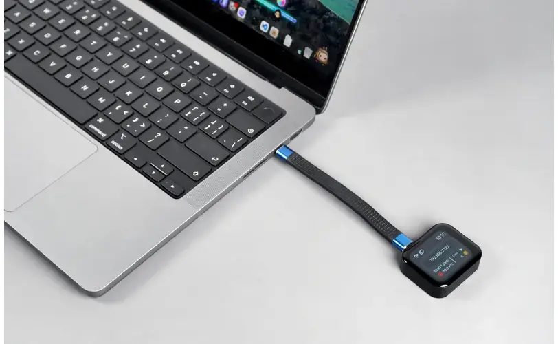
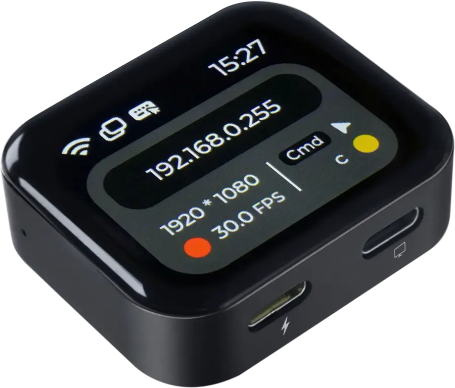
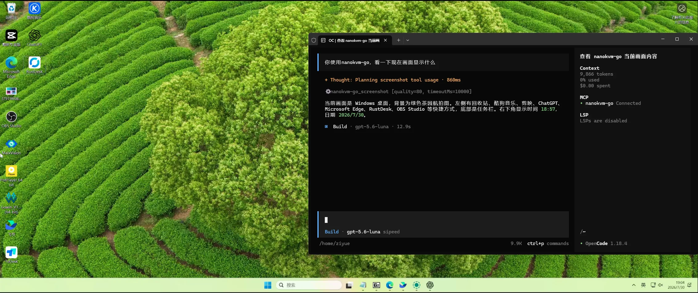
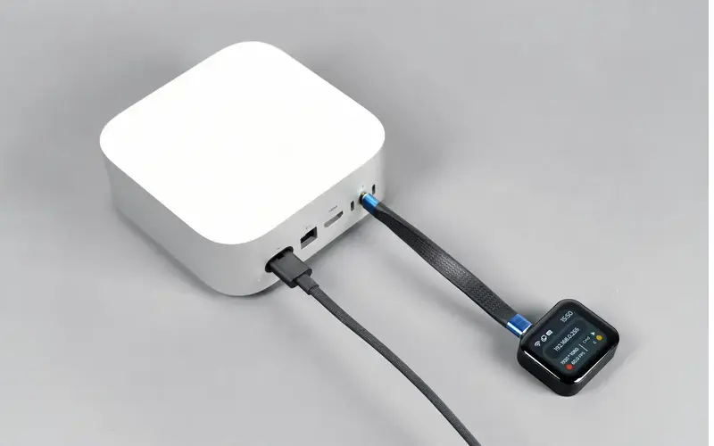
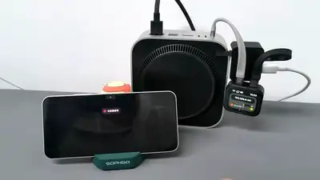

# NanoKVM-Go Nomad

[English](README.md) | 中文

   
  
  <h3>
    <a href="https://wiki.sipeed.com/hardware/zh/kvm/NanoKVM_Go/quick_start.html">🚀 快速开始</a>
     |
    <a href="https://wiki.sipeed.com/hardware/zh/kvm/NanoKVM_Go/user_guide.html">📖 使用指南</a>
     |
    <a href="https://github.com/sipeed/NanoKVM-Go/releases/latest">💾 Sipeed 官方固件</a>
  </h3>
   

## 🌟 NanoKVM-go-Nomad 是什么？

NanoKVM-go-Nomad 是 Sipeed NanoKVM-Go 的分支，适用于 **NanoKVM Go 系列**。该系列是 [Sipeed](https://sipeed.com) 推出的掌上 USB-C KVM，针对手机、平板和便携电脑优化。完成初始网络配置后，将它连接到支持 USB-C 视频输出的设备，即可从另一台手机或电脑的浏览器中查看画面，并进行点击、滑动和输入。

与远程桌面软件不同，NanoKVM Go 从硬件层采集画面，并以硬件方式模拟键盘、鼠标和存储设备。被控端无需安装专用驱动或远程控制客户端；即使操作系统卡死、无法联网或尚未启动，也能用于 UEFI/BIOS 设置、系统安装和故障排查，同样适合日常的远程协助。

Go 系列还提供完善的 AI 集成：可选的 MCP Server 让兼容 MCP 的 AI 工具获取画面并发送键鼠操作；Go+ 额外配备端侧 NPU、记忆织网与屏幕延时回放，可从画面变化中提取可检索的文字与上下文。

## Nomad 功能

**Go+ 远程摄像头。** 浏览器所在电脑的摄像头可作为标准 USB 摄像头提供给被控电脑。USB 端采用 1280 × 720 MJPEG，帧率为 30 fps。安装支持 UVC 的 Nomad 内核后，通过 HTTPS 打开控制台，在 **Settings → Device → Webcam** 中启用摄像头。切换时 USB 设备会重新连接。标准更新包含摄像头内核、脚本和视频帧输出程序。在运行 v1.0.10 固件的 Go+ 上，通过控制台上传更新，内核更换后重启一次。[内核补丁](support/patches/maix_ax620e_sdk_kernel/README.md)

点击工具栏的摄像头图标即可开始共享。将指针悬停在图标上或轻点旁边的箭头可选择摄像头。校准从 8 Mbps、25 fps 开始，先预热 1 秒，再连续采集五组、每组 2 秒的数据，通过二分搜索在 2–10 Mbps、15–30 fps 范围内调整。降低码率时也会适当降低帧率，以保留单帧细节。校准期间若被控电脑打开摄像头，画面会立即开始传输。传输期间若持续丢帧，控制器会调低目标值，传输稳定后再逐步提高。**Calibrating** 和 **Streaming** 显示接收码率、帧率和上传延迟。被控电脑空闲时，**Ready** 只显示校准后的目标码率和帧率。支持后台工作线程的浏览器可在线程中采集图像，Safari 等 WebKit 浏览器可通过视频元素采集。再次点击摄像头图标会释放本地摄像头并使 USB 画面恢复为黑屏。麦克风单独控制。[摄像头使用与校准](docs/remote-webcam.md)

使用配套内核时，USB 摄像头默认使用驱动提供的通用名称。可在 **Settings → Device → Advanced → USB Webcam Name** 中修改被控电脑看到的名称，下次启用摄像头或重启 Go+ 时生效。

在 **Settings → Screen → EDID** 中选择配置即可同时设置显示器名称和显示模式，无需单独设置 **Monitor Name**。

**菜单栏。** 初始工具栏沿用上游默认设置，鼠标抖动器快捷入口默认隐藏，可在外观设置中启用。启用 USB 摄像头后会显示摄像头快捷入口。音量未静音、摄像头已开启或鼠标抖动器已启用时，相应图标显示绿色。点击鼠标抖动器图标即可按上次选用的模式启动或停止。点击 **Screen** 可切换只读模式，在 **Screen → Cropping** 中可选择自动裁剪、手动选区或关闭裁剪。点击音量图标可静音或恢复之前的音量，点击终端图标可在新标签页中打开终端。

**连接时启用。** 在 **Settings → Appearance → Activate on Connect** 中，可分别设置当前浏览器连接或重新连接时是否启用音量、麦克风、摄像头和鼠标抖动器。隐藏图标不影响该设置，隐藏的摄像头或麦克风仍可在外观设置中停止共享。摄像头需先在设备设置中启用，音量和麦克风需使用 WebRTC 模式。

**USB 端点。** **Settings → Device** 显示 Go+ 的 7 个 USB IN 端点中已用和可用的数量。在 **Mouse → Mouse mode → Use one USB pointer endpoint** 中可释放一个端点。切换会短暂重连所有用户的 USB 设备。单端点模式下，抖动器使用当前鼠标端点；选择触控笔或多点触控时，抖动器暂停移动。

**鼠标抖动器。** 默认关闭。在 **Settings → Device → Mouse Jiggler** 中启用后，可选择相对模式（默认，发送位移量）或绝对模式（发送屏幕坐标）。将指针悬停在工具栏图标上，或在触摸屏上轻点菜单箭头，即可设置 **max runtime**。输入整数小时或用箭头调整，修改后自动保存。默认运行 **8 小时**，设为 **0** 可无限运行。菜单显示 `HH:mm:ss remaining` 或 `∞ remaining`。运行期间改为 6 小时，会立即从 6 小时重新倒计时。关闭再开启也会重新计时。关闭浏览器后设备仍会运行，重启 Go+ 后则按原截止时间继续计时。

通过 Go+ 的键鼠输入停止 30 秒后，设备会再随机等待 0–30 秒。下一次动作因此会在空闲 **30–60 秒**后开始。新的远程键鼠输入会中断当前动作并重新计算空闲时间，运行时限继续倒计时。只要仍有桌面标签页连接（包括后台标签页），或距最后一个连接断开不超过 5 分钟，设备就会轻微移动指针。相对模式让指针移出后返回，绝对模式则在屏幕中央附近发出两个相邻坐标。

所有桌面连接断开超过 5 分钟后，每次动作会改为持续 **5–8 秒**的随机弧线或钩形曲线。重新连接会中断曲线。指针沿曲线平滑加减速，不点击或滚动。曲线随 HDMI 分辨率调整。当估计位置位于屏幕某一轴两端各四分之一的范围内时，曲线沿该轴向内移动。Go+ 根据已发送的坐标和位移估计指针位置，主机指针加速度和直接连接主机的鼠标都可能造成偏差。

**默认设置和项目标识。** 升级时保留已选的 EDID 配置，时区和网页标题沿用上游默认值，恢复出厂设置使用 Asia/Shanghai。Wi-Fi 页面、关于页面和更新页面保留 Nomad 项目标识。**Check for Updates** 显示上游应用版本和 Nomad 构建编号。

## 📦 产品家族

NanoKVM 是一系列紧凑的开源 IP-KVM 设备，可根据部署场景选择：

- **NanoKVM Go**（本仓库）：面向手机、平板、笔记本、迷你主机和掌机的 USB-C KVM。一根全功能 USB-C 线缆即可同时承载视频、音频、键鼠输入、虚拟介质和虚拟网卡。
- **NanoKVM Go+**（本仓库）：在 NanoKVM Go 的基础上，增加 3.2 TOPS NPU、更大的内存与存储，以及记忆织网和屏幕延时回放。
- **[NanoKVM Cube / PCIe](https://github.com/sipeed/NanoKVM)：** 基于 LicheeRV Nano（SG2002）的经典型号，支持 1080P @ 60 fps 采集，并提供 PCIe 形态。
- **[NanoKVM-Pro](https://github.com/sipeed/NanoKVM-Pro)：** 高性能型号，支持 4K 采集、HDMI 环出、千兆网口和 PoE。
- **[NanoKVM-USB](https://github.com/sipeed/NanoKVM-USB)：** 基于 USB 的 KVM 方案，被控端无需联网。
- 🔜 **[NanoKVM Air](https://github.com/sipeed/NanoKVM-Air)：** 入门级、低成本 IP-KVM，支持 1080P @ 60 fps、双频 Wi-Fi、1.47 英寸触摸屏和手指机器人。即将上市，敬请期待!!!

两个 Go 型号的 KVM、MCP、无线网络和扩展能力相同；需要更强 AI 算力、记忆织网和屏幕延时回放时选 Go+。

## ✨ 功能特性

### 一根 USB-C 线实现 4K 远程控制

主 USB-C 接口只需接一根线：被控设备的画面（最高 4K @ 50 Hz）和声音传回来，你的键鼠操作传过去，不需要额外的采集卡或转接器。需要装系统或传文件时，被控设备会多出一个 U 盘；需要联网时，也可以给它加一块网卡。另一个 USB-C 接口用来接电源，把电直接送给被控设备，长时间使用也不怕没电。

  

### 配备彩色触摸屏

1.83 英寸彩色触摸屏显示 IP 地址、当前分辨率和帧率，也可以直接完成 Wi-Fi、显示和会话设置。平台开放，支持安装自定义应用，把这块小屏幕变成时钟、系统监控或桌面小部件。

  

### 将真实设备接入 AI Agent

MCP 是一种让 AI 调用外部工具的协议。如果你在用支持它的 AI 工具，可以让它直接看到被控设备的画面、替你点击和打字：AI 会先截一张当前画面确认状态，再执行操作。MCP 默认关闭，需要你在设置里手动打开。

如果用的是 Go+，还额外支持记忆织网和屏幕延时回放：记忆织网会把屏幕上的文字和上下文整理成可检索的记录，屏幕延时回放可以按时间回看历史画面，并搜索其中的内容。

  
   
  点击查看完整截图

### 支持多种远程访问方式

不在家也能远程访问：内置 Tailscale，还支持 ZeroTier、NetBird、frp 和 Cloudflare Tunnel，不必在自家路由器上做端口映射。画面采集与键鼠模拟都在硬件层完成，被控设备上不用装任何常驻软件；把线拔掉，远程连接就断开了。

  

## 🧭 典型应用场景

### 远程协助家人使用手机和平板

把配置好 Wi-Fi 和远程访问的 NanoKVM Go 留在家中。家人需要帮助时，用一根全功能 USB-C 线把它接到手机或平板，你就可以从自己的手机或电脑浏览器里直接查看并操作设备，不必再在电话里一步步描述按钮的位置。

  

### 随身维护笔记本、迷你主机和掌机

NanoKVM Go 的机身约 45 × 40 × 15 mm，可以放进工具包，在 MacBook、迷你主机、Windows 笔记本和 Steam Deck 之间随插随用。机身内置磁铁，也可以吸附在机箱或金属支架上。

  

### 系统无法启动时远程救援

当设备卡死、无法联网或进不了系统时，远程桌面和 SSH 往往也一起失效。NanoKVM Go 仍然能输出启动画面，让你进入 UEFI/BIOS、修改启动项，或者挂载 ISO 镜像重装系统。

  

如果设备彻底无响应，既进不了系统也无法连网，还可以加装手指机器人：把它固定在机箱电源键旁边，就能从远端物理按下电源键，完成开机、关机或强制断电（长按电源键可能丢失未保存的数据）。接线和操作见[手指机器人使用指南](https://wiki.sipeed.com/hardware/zh/kvm/NanoKVM_Go/finger_robot.html)。

  
   
  完整演示，点击查看视频

## 🛠️ 技术规格

| 项目 | NanoKVM Go / Go+ | NanoKVM Cube / PCIe | NanoKVM-Pro |
| --- | --- | --- | --- |
| 核心 | Go：2 × Cortex-A53 Go+：2 × Cortex-A53 + 3.2 TOPS NPU | 1 × C906 @ 1.0 GHz | 2 × Cortex-A53 @ 1.2 GHz |
| 内存与存储 | Go：256 MB LPDDR4x + 16 GB Go+：512 MB LPDDR4 + 64 GB | 256 MB DDR3 + 32 GB | 1 GB LPDDR4X + 32 GB |
| 最大采集 | 4K @ 50 Hz；2K @ 90 Hz | 1080P @ 60 fps | 4K @ 45 fps；2K @ 95 fps |
| 编解码器 | H.264 / H.265 | MJPEG / H.264 | MJPEG / H.264 / H.265 |
| 音频传输 | 双向音频 | — | 双向音频 |
| UEFI / BIOS | ✓ | ✓ | ✓ |
| 模拟 USB 键鼠 | ✓ | ✓ | ✓ |
| 模拟 USB ISO | ✓ | ✓ | ✓ |
| 网络唤醒 | ✓ | ✓ | ✓ |
| Web 终端 | ✓ | ✓ | ✓ |
| 自定义脚本 | ✓ | ✓ | ✓ |
| Wi-Fi | 内置 Wi-Fi 6 | 可选 Wi-Fi 6 | 可选 Wi-Fi 6 |
| 显示屏 | 1.83 英寸彩色触摸屏 | 0.96 英寸 OLED | 1.47 英寸 LCD / 0.96 英寸 OLED |
| 其他功能 | Go：手指机器人、MCP Go+：手指机器人、MCP、记忆织网、屏幕延时回放 | MCP | 灯带同步、智能助手 |
| 供电 | USB-C PD | USB-C / PoE / PCIe | USB-C / PoE |
| 尺寸 | 45 × 40 × 15 mm | 40 × 36 × 36 mm | 65 × 65 × 28 mm |

> 表中为硬件最高采集能力，实际可选模式由 EDID、操作系统和接口能力决定，详见[分辨率与 EDID 设置](https://wiki.sipeed.com/hardware/zh/kvm/NanoKVM_Go/resolution.html)。Go 的 4K @ 50 Hz 目前为 Beta；Pro 的 4K45 / 2K95 需后续更新，出厂默认 4K30 / 2K60。

## 📂 仓库结构

本仓库是该系列的构建与打包入口。各组件构建产物汇总到 `build/`，随后打包为 Debian 软件包。

| 目录 | 内容 |
| --- | --- |
| [`server/`](server) | Go 后端：API、认证、HID、推流、扩展 |
| [`web/`](web) | React + TypeScript 前端 |
| [`kvm_ui/`](kvm_ui) | 设备本地 LVGL 触摸界面 |
| [`kvm_vin/`](kvm_vin) | 视频采集与编码流水线 |
| [`libkvm/`](libkvm) | 硬件抽象库 |
| [`nano_ocr/`](nano_ocr) | OCR 运行时 |
| [`memfab/`](memfab) | 记忆织网运行时，提供 OCR 支撑的本地记忆 |
| [`debhelper/`](debhelper) | `kvmcomm` 与 `nanokvm-go` 的 Debian 打包 |
| [`support/`](support) | 工具链配置、打包脚本、内核补丁、发布公钥 |
| [`docs/`](docs) | 架构、API 与构建文档 |

`debhelper/packages/kvmcomm/rootfs/kvmcomm/apps` 是一个 Git 子模块。克隆时请加 `--recurse-submodules`，或在克隆后执行 `git submodule update --init --recursive`。

## 📚 文档

完整的产品文档见 [Sipeed Wiki](https://wiki.sipeed.com/hardware/zh/kvm/NanoKVM_Go/introduction.html)：[快速开始](https://wiki.sipeed.com/hardware/zh/kvm/NanoKVM_Go/quick_start.html) · [使用指南](https://wiki.sipeed.com/hardware/zh/kvm/NanoKVM_Go/user_guide.html) · [系统编译](https://wiki.sipeed.com/hardware/zh/kvm/NanoKVM_Go/system/introduction.html) · [烧录镜像](https://wiki.sipeed.com/hardware/zh/kvm/NanoKVM_Go/system/flashing.html) · [常见问题](https://wiki.sipeed.com/hardware/zh/kvm/NanoKVM_Go/faq.html)。

| 文档 | 说明 |
| --- | --- |
| [构建与打包指南](docs/build-packaging.md) | 仓库内构建、Debian 打包、update bundle 与签名细节 |
| [更新日志](CHANGELOG.md) | 主要变更与版本历史 |
| [MCP 使用说明（英文）](docs/mcp-usage.md) | 在 AI 客户端中启用并使用 MCP 服务 |
| [存储与文件共享](docs/storage.md) | 虚拟介质、ISO/IMG 挂载与文件传输 API |
| [输入路由架构](docs/input-router.md) | 输入路由、会话归属与已验证的客户端矩阵 |
| [USB HID 说明](docs/kvmgo-device-usb-hid.md) | 鼠标、数位笔与多点触控的 HID 报文描述符 |
| [双因素认证](docs/2fa.md) | TOTP 配置与运行时文件 |

## 🔌 兼容性

被控设备的 USB-C 接口必须支持 **DisplayPort Alt Mode** 才能输出画面；仅支持充电或普通 USB 数据传输的接口无法使用。Apple 设备仅限 wiki 中列出的型号范围（例如 iPhone 15 及后续机型，不含 iPhone 16e / 17e，且需开启辅助触控）。控制端只需一台能访问 NanoKVM Go 的现代浏览器。

完整且最新的兼容列表见 [Wiki 兼容设备章节](https://wiki.sipeed.com/hardware/zh/kvm/NanoKVM_Go/introduction.html#兼容设备)。

## 🤝 参与贡献

欢迎提交 issue 与 pull request。参与方式：

1. Fork 本仓库。
2. 新建功能分支。
3. 提交改动。
4. 推送到该分支。
5. 发起 Pull Request。

提交前请确保相关组件可以正常构建且测试通过，尽量让每个 PR 小而聚焦，并让每个提交只覆盖一处改动。

## 🛒 购买

- [淘宝](https://item.taobao.com/item.htm?id=1093779349345)
- [速卖通](https://www.aliexpress.us/item/3256813383201819.html)

## 💬 社区与支持

- [Discord](https://discord.gg/V4sAZ9XWpN)
- QQ 群：703230713
- 邮箱：[support@sipeed.com](mailto:support@sipeed.com)
- [常见问题](https://wiki.sipeed.com/hardware/zh/kvm/NanoKVM_Go/faq.html)

## 📜 许可证

NanoKVM-Go 基于 [GNU General Public License v3.0](LICENSE) 发布。
